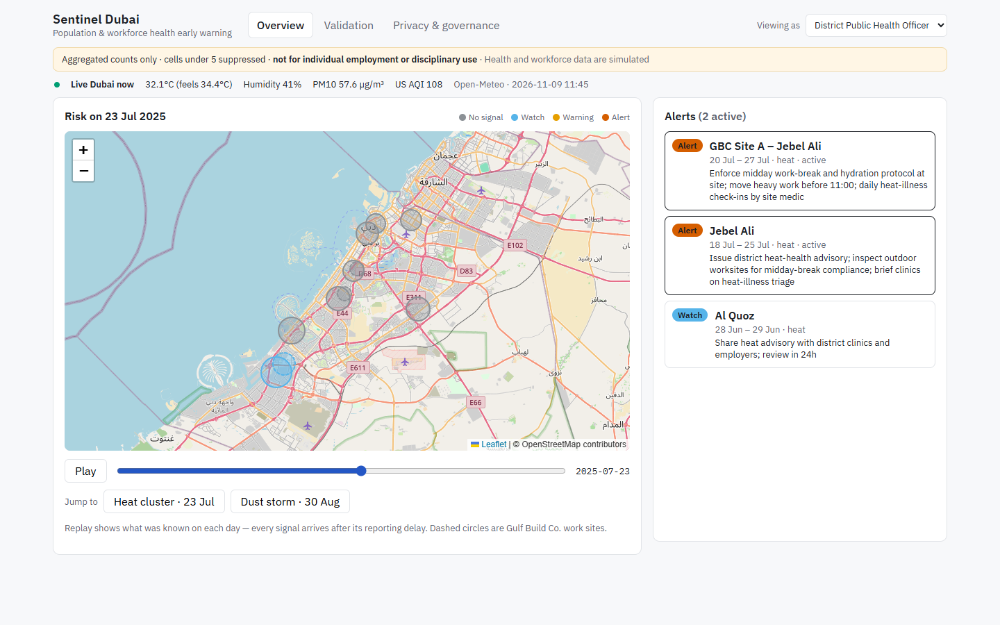
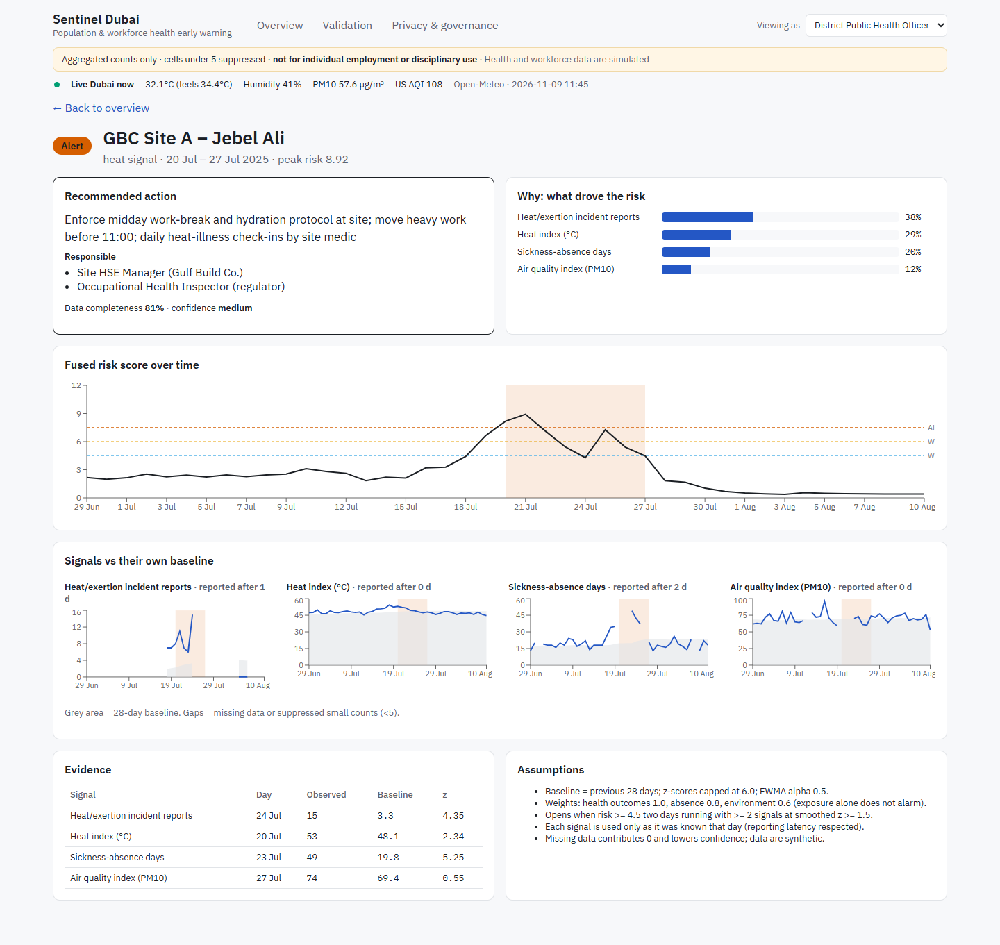
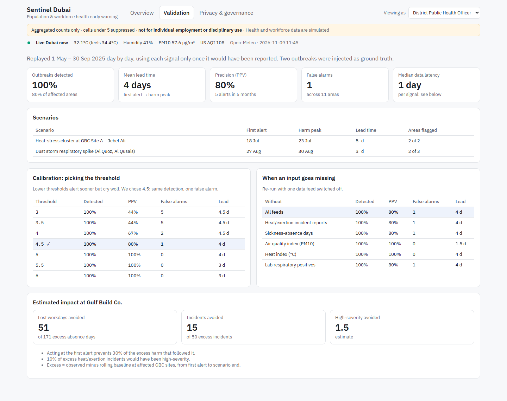
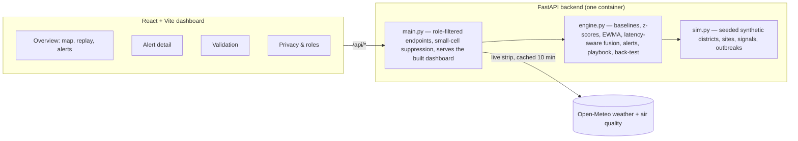

# Sentinel Dubai — population & workforce health early warning

[](https://github.com/ArhamAzad2004/health-early-warning/actions/workflows/ci.yml) [](LICENSE)

**Live demo: https://sentinel-dubai.onrender.com** (free hosting: the first visit after a quiet spell can take up to a minute to wake up)

Early signs of a health threat rarely sit in one dataset: a few extra clinic visits, more sick days at a
company, extra incident reports on a building site, an unusually hot or dusty day. Sentinel Dubai fuses clinic visits, lab positives, sickness absence, occupational incident reports, heat index and air quality
for Dubai districts and a (fictional) construction employer, Gulf Build Co., and raises **explainable,
privacy-preserving alerts** that name a proportionate action and who should take it.

Health and workforce data are **simulated** (fixed seed, two injected outbreaks). Live Dubai weather and air
quality come from [Open-Meteo](https://open-meteo.com) (free, no key).

## Screenshots

**Overview** — replay the season on a map of Dubai; alerts list the action and who should take it.



**Alert detail** — what drove the risk, the recommended action and owner, each signal against its own baseline, evidence and assumptions.



**Validation** — back-test results, threshold calibration, missing-feed behaviour and estimated impact.



## Architecture



Everything runs in memory: at startup the backend generates the data, scores every area, finds alerts and runs
the back-test once; requests only read, filter by role and suppress small counts.

## What it does

| Capability | Where to see it |
|---|---|
| 1. Multi-signal surveillance | 7 signals of 5 kinds (service, lab, workplace, occupational, environmental) on the map |
| 2. Explainable detection | Alert page: contribution bars, risk timeline, each signal against its own baseline |
| 3. Decision support | Alert page: recommended action, responsible roles, evidence table, assumptions; Overview: notifications sent to each role as alerts open |
| 4. Privacy | Banner, `<5` suppression, role switcher (public health / employer HSE / public) |
| 5. Validation | Validation tab: lead time, detection, PPV, false alarms, latency, threshold calibration, missing-feed and unknown-location stress tests |
| 6. Impact | Validation tab: estimated lost workdays and incidents avoided, with stated assumptions |
| 7. Regulator summary | Validation tab: **Download CSV** or **Print summary** (aggregated, small counts hidden) |

Current back-test: both outbreaks caught **3–5 days before their harm peak**, PPV 80%, 1 false alarm in 5 months across 11 areas. GBC Site B was missed in the dust-storm scenario — **accepted known limit**, surfaced on the Validation page.

## Engineering highlights

- **Explainable statistics, not a black box:** rolling baselines, z-scores and EWMA fused into one risk score; every alert shows each signal's share, evidence and assumptions.
- **Honest validation:** a day-by-day back-test that only uses each signal once it would really have been reported, plus a threshold calibration sweep and missing-feed re-runs.
- **Privacy by design:** aggregated counts only, small-cell suppression enforced in the API (including a bypass found in a security audit and closed with a regression test), role-based views, and a privacy test matrix that checks every endpoint for every role.
- **Production habits:** CI on every pull request (lint, unit and privacy tests, build, Docker image smoke test, and an end-to-end browser test of the demo path), pinned dependencies with Dependabot, security headers, one-command setup, single-container deploy on Render.

## Data, assumptions and limits

- **Data sources:** health and workforce data are generated by `backend/app/sim.py` (fixed seed, two injected outbreaks); live weather and air quality come from the free, public Open-Meteo API. No personal data is used.
- **Assumptions:** signal weights, thresholds and the impact estimate (30 % of excess harm prevented) are stated on every alert and on the Validation page.
- **Known limits:** GBC Site B is missed in the dust-storm scenario; one false alarm (Al Quoz, late June); the role switcher demonstrates role-based views but is not real authentication.
- Details: [TRD §11](docs/TRD.md).

## Run it locally

Needs Python 3.11+ and Node 20+. From the project folder:

```bash
npm run setup
```

```bash
npm run dev
```

Open http://localhost:5173, press **Play** on the timeline, then click an alert.

Tests: `npm test`

## Deploy (one public link)

Live at https://sentinel-dubai.onrender.com, redeployed automatically on every merge to `main`.

The `Dockerfile` builds the dashboard and serves it from the API, so the whole demo is one app.
On [Render](https://render.com): **New → Blueprint**, pick this repo, and it reads `render.yaml`
(free plan, redeploys on every merge to `main`). Locally, `npm run build` in `frontend/` then start
the backend and open http://localhost:8000.

## Roadmap

Open work is tracked in [issues](https://github.com/ArhamAzad2004/health-early-warning/issues) under the
[v1.0 portfolio release](https://github.com/ArhamAzad2004/health-early-warning/milestones) milestone:
a public live link, alert notifications, handling unknown locations, and a regulator summary export.

## Layout

- `backend/app/sim.py` — synthetic Dubai districts, work sites, signals and injected scenarios
- `backend/app/engine.py` — baselines, z-scores, fused risk, alerts, playbook, back-test
- `backend/app/main.py` — FastAPI endpoints with role filtering and small-cell suppression
- `frontend/src/` — React dashboard (Leaflet map, Recharts charts)
- `docs/` — PRD, TRD, app flow, design brief, backend schema, implementation plan
