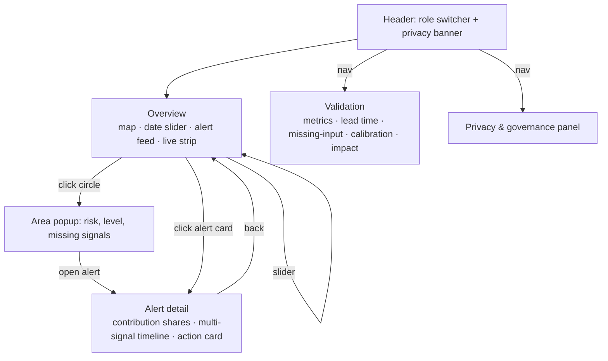

# Sentinel Dubai — App Flow

## 1. Roles and what each one sees

| Role (`?role=`) | Areas (`/api/areas`) | Signals (`/api/signals`) | Alerts (`/api/alerts`) | Validation (`/api/backtest`) |
|---|---|---|---|---|
| `public_health` | All 8 districts + 3 GBC sites | All signals of the area (sites include parent-district `heat_index`, `aqi`) | Full alert objects | Full |
| `employer_hse` | GBC Site A, B, C only | `absence`, `incidents`, `heat_index`, `aqi` | Full alert objects for sites | Full |
| `public` | 8 districts only | `heat_index`, `aqi` only | Trimmed: `id, area_id, area, start, end, level, action, category` | 403 |

Any area outside the role's scope → 404. The role is chosen with a switcher in the header; changing it re-fetches every view. There is no login in the prototype. The Occupational Health Inspector (regulator) uses the `public_health` view; a dedicated role is a stretch goal.

## 2. Screen flow

## 3. Screens

### Overview
- **Map** (Leaflet): one circle per area from `/api/areas`, radius and colour by `level` from `/api/risk?date=`; label always shows the level word (`normal`, `watch`, `warning`, `alert`).
- **Date slider**: `/api/meta` gives `start`/`end` (2025-05-01 → 2025-09-30) and the three thresholds; play button steps 1 day per ~150 ms.
- **Alert feed**: alerts from `/api/alerts` whose `start` ≤ selected date, newest first; each card shows `area`, `level`, `start`–`end`, top two `contributions`, `completeness`.
- **Live strip**: `/api/live` → temperature, humidity, feels-like, PM10, PM2.5, US AQI, dust; "Live feed unavailable" when `ok` is false.
- **Role switcher** and **privacy banner** in the header on every page.

### Alert detail
- Title: `area`, `level`, `start`–`end`, `peak_risk`, `completeness`, `confidence`.
- **Contribution shares**: one bar per signal from `contributions` (already sorted descending), labelled with percentage.
- **Multi-signal timeline**: from `/api/signals?area_id=`; each signal on its own small chart with `value`, `baseline` band, alert window shaded; `suppressed` points drawn as "<5" ticks, `missing` days as gaps. The area's daily `risk` line with the three threshold lines underneath.
- **Action card**: `action`, `roles`, `category`, evidence table (`label`, `date`, `value`, `baseline`, `z`, `share`), `assumptions` list.

### Validation
- Metric tiles: `sensitivity`, `area_sensitivity`, `ppv`, `false_alarms`, `median_latency_days`, `mean_lead_time_days`.
- Per-scenario table: `name`, `areas_affected`, `areas_hit`, `peak`, `first_alert`, `lead_time_days`, `detected`.
- Missing-input table: one row per `missing_input` entry (`without` incidents / absence / aqi / heat_index / lab_resp_pos).
- Calibration table: `threshold` 3.0 … 6.0 with sensitivity, PPV, false alarms, mean lead time; the 4.5 row highlighted.
- Impact card: `excess_absence_days`, `avoided_lost_workdays`, `excess_incidents`, `avoided_incidents`, `avoided_high_severity_incidents`, with the `assumptions` text beside them.

### Privacy & governance panel
- Purpose, data types, aggregation and suppression rule, who sees what per role, retention (none in prototype), prohibited uses, audit log (future).

## 4. User journeys

### District Public Health Officer (`public_health`)
1. Opens Overview; scans map on today's slider position; reads live strip.
2. Late August: Al Quoz and Al Qusais at warning; clicks a circle; popup shows level and any missing signals.
3. Opens the alert; `aqi` share is high and came first (exposure memory), then `resp_visits`, then `lab_resp_pos` three days later because of its reporting latency.
4. Reads the respiratory action: issue district air-quality advisory, alert clinics and labs, advise outdoor workers. Roles: District Public Health Officer, Environmental Health Officer.
5. Checks Validation to see the false alarm count and the calibration sweep before acting.

### Employer HSE Manager (`employer_hse`)
1. Switches role; map shows only three GBC sites.
2. Mid-July: Site A – Jebel Ali opens an alert; `incidents`, `absence` and `heat_index` (from Jebel Ali district) lead.
3. Action: midday work-break and hydration protocol; move heavy work before 11:00; daily heat-illness check-ins. Roles: Site HSE Manager (Gulf Build Co.), Occupational Health Inspector (regulator).
4. Completeness is lowered by the 20–22 July absence feed outage and the card says so.
5. Cannot see any individual, any district clinic count, or any other employer.

### Occupational Health Inspector (regulator)
Uses the `public_health` view. Sees site alerts where "Occupational Health Inspector (regulator)" is listed in `roles`, opens evidence and assumptions, and uses the Validation page to judge whether the alert threshold is reasonable before acting.

### Public
1. Switches role; sites disappear; Validation is not available.
2. Sees district heat index and AQI and the advisory `action` text; no counts, no workplace data.

## 5. Demo click path (matches the PRD script)

1. Load `http://localhost:5173` as `public_health`. Point at the live strip.
2. Press play on the slider; pause around 2025-07-18 when GBC Site A turns watch and the alert opens.
3. Click the Site A circle → popup → open alert.
4. Walk the contribution shares, then the timeline (heat index first, incidents and absence next). Open the Jebel Ali district alert to show heat-illness visits following.
5. Scroll to the action card; read action, roles, evidence, assumptions, completeness, confidence.
6. Back to Overview; switch role to `employer_hse` (sites only), then `public` (districts, advisories only). Hover a "<5" cell. Point at the banner.
7. Navigate to Validation; read the metric tiles and per-scenario lead times (5 and 3 days); point at the missing-input rows, the calibration row for 4.5, and the impact card.
8. Open Privacy & governance for the closing line.

## 6. Empty and error states

- `/api/live` returns `ok: false` → strip shows "Live feed unavailable (Open-Meteo)"; nothing else changes.
- Date before any alert → feed shows "No alerts open on this date".
- `public` role → Validation page shows "Validation detail is for public health and employer roles" (the API's 403 message).
- `/api/risk` with a date outside the window → 400; the slider never produces one.
- Backend down → single page-level message "Backend not reachable on :8000" with the run command.
