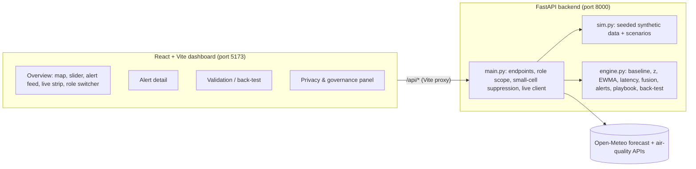

# Sentinel Dubai — Technical Requirements (TRD)

## 1. Architecture

Everything lives in memory. On startup `main.py` calls `generate()` (seed 42), `engine.run()` to score every area and find alerts, and `engine.backtest()` once. Requests only read, filter by role and suppress.

## 2. Components

| File | Responsibility |
|---|---|
| `backend/app/sim.py` | 153 days (2025-05-01 … 2025-09-30) × 11 areas. Seasonal heat, Poisson counts, two injected scenarios, ~3 % random nulls, one 3-day absence feed outage at Site A (20–22 Jul). |
| `backend/app/engine.py` | Baseline/z/EWMA per signal, latency-aware daily risk with contributions, alert opening/closing, description (shares, evidence, completeness, confidence), playbook, back-test metrics, missing-input re-runs, calibration sweep, impact estimate. |
| `backend/app/main.py` | Endpoints `/api/meta`, `/api/areas`, `/api/signals`, `/api/risk`, `/api/alerts`, `/api/backtest`, `/api/live`. Role visibility, suppression, public-role trimming, Open-Meteo fetch. |
| `frontend/` | Overview, Alert detail, Validation, Privacy pages; one role state; Leaflet map; simple charts. |

## 3. Data model summary

Areas: 8 districts (`deira`, `bur_dubai`, `al_quoz`, `al_qusais`, `jebel_ali`, `dubai_marina`, `business_bay`, `silicon_oasis`) with `size`, and 3 sites (`gbc_site_a/b/c`) with `workers` and `parent` district. All have `name`, `type`, `lat`, `lon`.

| Signal | `kind` | Level | Latency (days) | Count? |
|---|---|---|---|---|
| `resp_visits` | service | district | 1 | yes |
| `heat_visits` | service | district | 1 | yes |
| `lab_resp_pos` | laboratory | district | 3 | yes |
| `absence` | workplace | site | 2 | yes |
| `incidents` | occupational | site | 1 | yes |
| `heat_index` | environmental | district | 0 | no |
| `aqi` | environmental | district | 0 | no |

A site's series is its own `absence` and `incidents` plus the `heat_index` and `aqi` of its parent district (`area_series()`).

## 4. Detection method (plain words, then formulas)

For each area and signal, every day we ask "is today unusually high compared with the previous four weeks?" We turn the answer into a z-score, keep only the upward direction, cap it, smooth it so one noisy day does not dominate, and only use each signal as it would actually have been known that day. Then we add the signals together with weights into one risk score per area per day.

1. **Baseline.** History = the previous 28 days, today excluded, nulls dropped. Needs at least 7 values, otherwise baseline and z are `null`.
   `mean = fmean(hist)`, `sd = pstdev(hist)`, floored: counts `sd = max(sd, sqrt(mean), 1.0)`; environmental `sd = max(sd, 0.5)`.
2. **Z-score, positive only, capped.** `z = clamp((x − mean) / sd, 0, 6)`. A missing day has `z = null`.
3. **EWMA smoothing.** `ew_t = 0.5 · (z_t or 0) + 0.5 · ew_{t−1}`.
4. **Latency.** On day D a signal with latency L is read at day `j = D − L`. If `j < 0` or the value at `j` is null, the signal is listed as missing for day D and contributes 0.
5. **Exposure memory (environmental only).** `heat_index` and `aqi` use `max(ew_k for k in j−6 … j)`: a dust or heat spike keeps counting for 7 days, because coughs and heat illness follow exposure with a lag.
6. **Fused risk.** `risk_D = Σ w_s · ew_s`, weights `resp_visits 1.0, heat_visits 1.0, lab_resp_pos 1.0, incidents 1.0, absence 0.8, heat_index 0.6, aqi 0.6`. Environment is weighted below outcomes so exposure alone cannot alarm.
7. **Levels.** `normal` < 4.5 ≤ `watch` < 6.0 ≤ `warning` < 7.5 ≤ `alert`. WATCH = 4.5 was chosen from the calibration sweep (3.0–6.0 in 0.5 steps) reported by the back-test.
8. **Corroboration.** A day is "gated" when `risk ≥ 4.5` **and** at least 2 signals have `ew ≥ 1.5` **and** at least one of those is a count (health/workplace) signal. Weather alone never alarms.
9. **Persistence.** An alert opens on the second consecutive gated day and closes after 2 consecutive days with `risk < 4.5`. The alert's level is the level of its peak-risk day.
10. **Contributions.** `share_s = Σ_window (w_s · ew_s) / Σ_window risk`, sorted descending. Evidence is produced for every signal with share ≥ 5 %: the latency-adjusted day inside the window with the highest z, giving `value`, `baseline`, `z`.
11. **Completeness and confidence.** `completeness = 1 − missing cells / (days × signals)` over the window. `high` ≥ 0.90, `medium` ≥ 0.75, else `low`.

Why this and not a model: it is explainable line by line, has no training set to overfit, and judges can check the arithmetic against the numbers on screen. The whole engine is plain Python with the `statistics` module — no NumPy.

## 5. Decision support (playbook)

`heat = Σ shares of {heat_index, heat_visits, incidents} (+ absence share / 2 at a site)`; `resp = 1 − heat`; `urgent = level in {warning, alert}`.

| Branch | Condition | Action (urgent / lower level) | Roles |
|---|---|---|---|
| Site heat | site and `heat ≥ resp` | Enforce midday work-break and hydration protocol at site; move heavy work before 11:00; daily heat-illness check-ins by site medic / Remind site supervisors of heat protocol; increase water/shade checks; review in 24h | Site HSE Manager (Gulf Build Co.); Occupational Health Inspector (regulator) |
| District heat | district and `heat ≥ resp` | Issue district heat-health advisory; inspect outdoor worksites for midday-break compliance; brief clinics on heat-illness triage / Share heat advisory with district clinics and employers; review in 24h | District Public Health Officer; Occupational Health Inspector (regulator) |
| Respiratory | otherwise | Issue district air-quality health advisory; alert clinics and labs to expect respiratory demand; advise outdoor workers on masks and reduced exertion / Notify clinics of rising respiratory activity; monitor AQI and lab positives; review in 24h | District Public Health Officer; Environmental Health Officer (district) or Site HSE Manager (Gulf Build Co.) (site) |

Each alert also carries `category` (`heat` or `respiratory`) and five `assumptions` strings (window, cap, alpha; weights; opening rule; latency respected; missing data and synthetic data).

## 6. Privacy design

- All data is daily aggregate values per area. No person-level record exists anywhere.
- Small-cell suppression (`main.suppress`): any count signal with value 1–4 is returned as `value: null, suppressed: true`; 0 stays 0; environmental values are never suppressed. Baseline and z are still returned so charts stay explainable. The same rule is applied to the `value` inside each alert's `evidence` rows.
- Role scope is enforced in the API: `public_health` → all areas; `employer_hse` → sites only; `public` → districts only. Out-of-scope `area_id` → 404. Invalid role → 422.
- `public` additionally gets only `heat_index` and `aqi` in `/api/signals`, only `id, area_id, area, start, end, level, action, category` in `/api/alerts`, and 403 on `/api/backtest`.
- Boundary banner on every page: "Aggregated surveillance data. Not for individual employment or disciplinary use."

## 7. Back-test method

Detection is latency-aware by construction (step 4 above), so the stored alerts are already what an operator would have seen day by day. `engine.backtest()` then reports:

1. Per scenario: `detected`, `first_alert` (earliest alert start in any scenario area overlapping the window), `lead_time_days = peak − first_alert`, `areas_hit`, `areas_affected`, and `missed_areas` (affected areas with no alert — accepted known limits, e.g. GBC Site B in S2).
2. Overall: `sensitivity` (scenarios detected / 2), `area_sensitivity` (scenario-area pairs hit / 5), `ppv` (true alerts / all alerts), `false_alarms`, `total_alerts`, `mean_lead_time_days`, `data_latency_days` per signal, `median_latency_days` (median of the 7 latencies = 1).
3. `missing_input`: the same metrics re-run without `incidents`, `absence`, `aqi`, `heat_index`, `lab_resp_pos` in turn.
4. `calibration`: sensitivity, PPV, false alarms and mean lead time at watch thresholds 3.0 … 6.0.
5. `impact`: excess `absence` and `incidents` (observed − baseline) at GBC sites in scenario areas from first alert to scenario end; avoided = excess × 30 % effectiveness; high-severity = 10 % of avoided incidents. Assumptions returned as text.

Current result (seed 42): sensitivity 1.0, area sensitivity 0.8 (GBC Site B not alerted — accepted known limit, surfaced on the Validation page), PPV 0.8, 1 false alarm (Al Quoz, late June, heat pattern), lead time S1 5 days, S2 3 days.

## 8. Live data integration

- Weather: `https://api.open-meteo.com/v1/forecast?latitude=25.2048&longitude=55.2708&current=temperature_2m,relative_humidity_2m,apparent_temperature&timezone=Asia%2FDubai`
- Air: `https://air-quality-api.open-meteo.com/v1/air-quality?latitude=25.2048&longitude=55.2708&current=pm10,pm2_5,us_aqi,dust&timezone=Asia%2FDubai`
- No key, 6 s timeout, `urllib` only. Success → `ok: true` with `time, temperature, humidity, feels_like, pm10, pm2_5, us_aqi, dust, source`. Any failure → `ok: false, error, fetched`.
- Display only; live values do not enter detection (the data window is 2025, the feed is today).

## 9. Tech choices and why

| Choice | Why |
|---|---|
| FastAPI | Fast to write, automatic `/docs`, query validation for `role`. |
| Plain Python + `statistics` | Engine is ~250 readable lines; nothing to install beyond FastAPI/uvicorn. |
| In-memory, seeded | Zero setup, deterministic demo, restart = clean state. |
| React + Vite | Fast dev loop, proxy `/api` to 8000 with one config line. |
| Leaflet + OpenStreetMap tiles | Free map, no key, circle markers are enough. |
| Open-Meteo | Free, no key, has both weather and air quality. |

## 10. Non-functional requirements

- Startup (generate + score + back-test incl. 12 re-runs) < 5 s on a laptop.
- Any API call < 300 ms except `/api/live` (≤ 6 s then fallback).
- Deterministic: same seed → same alerts and metrics every run.
- Works offline except the live strip.
- Runs with `uvicorn app.main:app --reload --port 8000` in `backend/` and `npm run dev` in `frontend/`.

## 11. Limits (say these out loud)

- Health and workplace data are synthetic; scenario shapes are hand-designed, so metrics prove the method works on the designed cases, not on Dubai.
- Geolocation is at district/site level only; finer location would change what can be detected and what must be suppressed.
- No causal claims: the system says signals rose together, not that one caused another.
- Weights and thresholds are assumptions tuned on two scenarios; real deployment needs calibration on historical data.
- Live weather is real but not used for detection, because the simulated window is in the past.
